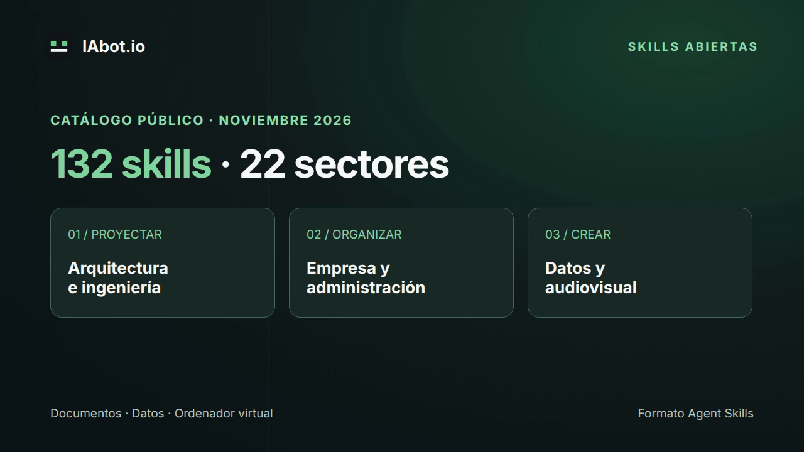

# IAbot.io · Ejemplo de vídeo con HyperFrames

[](iabot-skills-intro.mp4)

[Descargar el MP4](iabot-skills-intro.mp4) · [Composición editable](index.html)

Vídeo de 12 segundos, 1280 × 720 y 30 fps, renderizado localmente con
**HyperFrames 0.9.9**. Presenta las 132 skills y 22 colecciones publicadas el
3 de noviembre de 2026. No contiene audio: se ha diseñado como pieza visual
breve, sin voz ni música añadidas.

## Reproducir el proyecto

Requiere Node.js 22 o posterior, FFmpeg y un navegador compatible con el CLI.
Desde esta carpeta:

```sh
npm ci
npm run check
npm run render
```

El CLI gestiona el navegador y las fuentes según su configuración. La primera
preparación puede necesitar red; comprueba los requisitos con `npx hyperframes
doctor` y [su documentación](https://hyperframes.app/docs/1-startup/2-quickstart).
Este ejemplo utiliza el render local y no necesita activar un servicio de pago.

Las escenas se declaran como subcomposiciones; cada una tiene una línea de tiempo
pausada. Esto permite buscar un instante, avanzar y retroceder sin acumular el
estado de la animación. Los textos, tiempos y estilos se editan en `index.html`.

## Uso en IAbot.io

Asigna [Producción de vídeos con HyperFrames](https://github.com/Iabot-io/video-skills/tree/main/skills/hyperframes-project-video)
a un empleado audiovisual. Aporta el proyecto y pide, por ejemplo:

> Adapta este vídeo a nuestro encargo, conserva los recursos autorizados y entrega
> el MP4 con el proyecto editable. Revisa duración, textos y legibilidad.

Prepara las dependencias en el ordenador autorizado. Importar la skill conserva
sus instrucciones y enlaces; no instala este proyecto ni sus programas.

## Comprobación y procedencia

La revisión estricta del CLI terminó sin errores ni avisos. Se comprobaron los
metadatos, la decodificación completa y fotogramas de las tres escenas. Los
resultados están en [verification.json](verification.json). No se realizó un
render GPU ni una ejecución dentro de una empresa de producción.

El logotipo pertenece a IAbot.io. El texto y la composición son de este ejemplo.
HyperFrames y GSAP son dependencias de sus respectivos proyectos y conservan sus
licencias; no se incluyen sus paquetes en esta carpeta. Las cifras del catálogo
deben actualizarse si cambia el número de habilidades.
